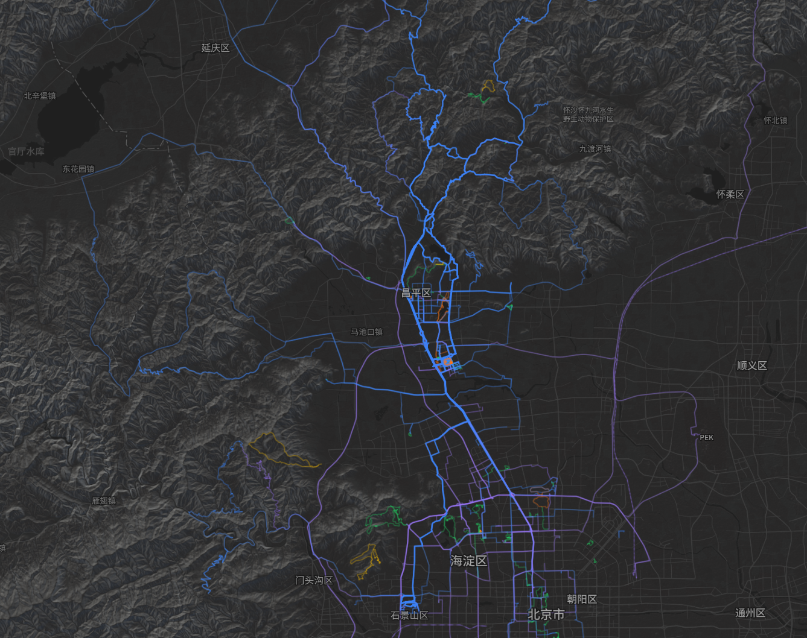
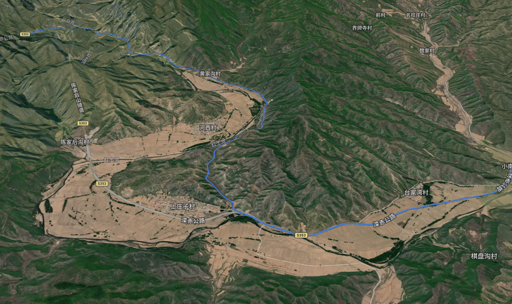
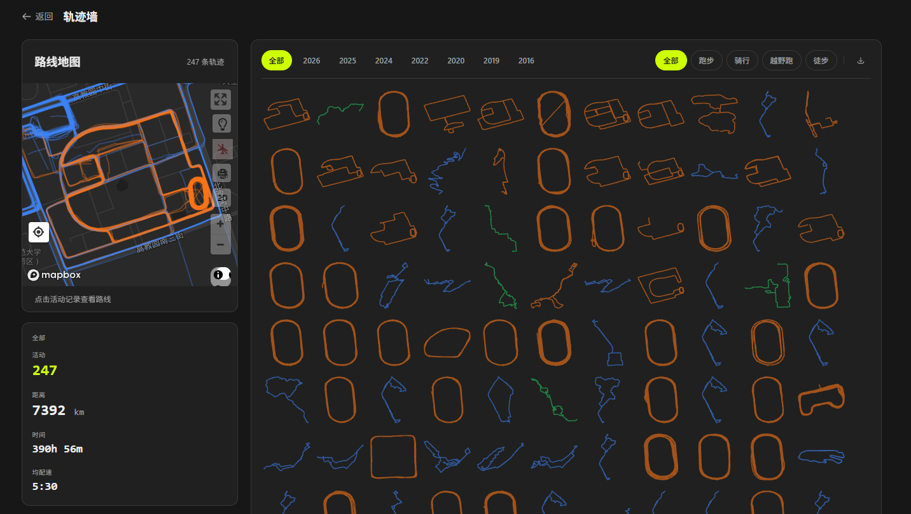
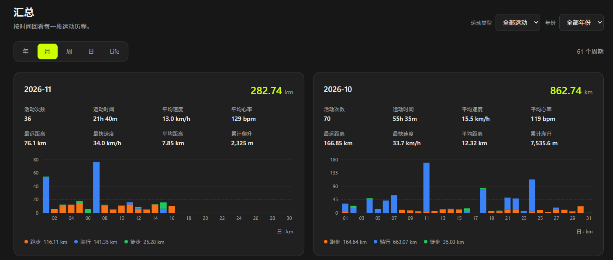
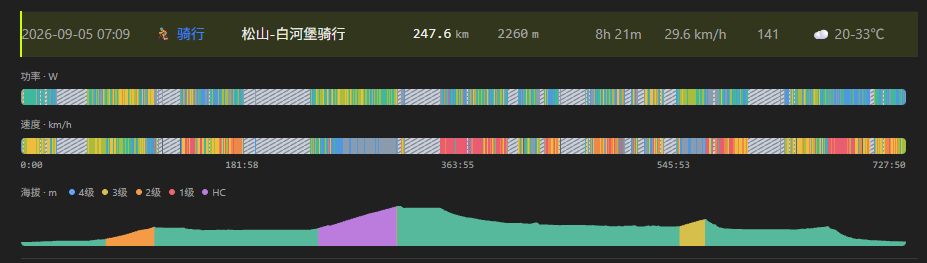
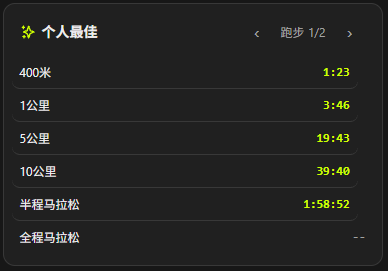

# Neewii Workouts

[简体中文](README.md) · **English**

Neewii Workouts is a personal map of workouts and travel, built on [running_page](https://github.com/yihong0618/running_page). Explore a trail run in 3D, see how much cycling contributed to a month's mileage, or follow a train journey alongside the routes you covered on foot.

GitHub Actions syncs your activities. Python prepares the data, and Vite builds the React and TypeScript frontend into a static site.



## Project credits

| Project | Contribution |
| --- | --- |
| [yihong0618/running_page](https://github.com/yihong0618/running_page) | The foundation for activity sync, storage, maps and statistics graphics. The dashboard also adapts components from this project. |
| [ben-29/workouts_page](https://github.com/ben-29/workouts_page) | The approach to recognizing multiple sports and organizing outdoor activities by type. |
| [zhaohongxuan/workouts](https://github.com/zhaohongxuan/workouts) | The design reference for the dashboard layout, activity heatmap, route gallery and statistics cards. |

## Explore the map and dashboard

### Satellite imagery and 3D terrain

Use the basemap selector to switch to satellite imagery, then select **3D** to see how a ride, hike or trail run follows the terrain. The map also supports light and dark themes, fullscreen mode, and filters by year and sport.



### Classic view and dashboard

The classic map and the newer dashboard share activity data and theme settings. Switching views keeps the selected activity, and your browser remembers which view you last used. The dashboard supports English and Chinese.

| Path | View |
| --- | --- |
| `/` | Classic on the first visit, then your last choice |
| `/classic` | Classic map |
| `/classic/summary` | Classic summary |
| `/dashboard` | Dashboard with goals, streaks, heatmap, activity list, places visited in China and a running scatter plot |
| `/dashboard/summary` | Multi-sport summary |

### Track wall

Each thumbnail represents one activity and is colored by sport. Select a thumbnail to see the route on the map. Filter by year or sport, sort by date or distance, or export the wall as an image. The heatmap can also be exported.



A recorded route qualifies when it meets the minimum distance for its sport.

| Sport | Minimum distance |
| --- | --- |
| Running, trail running or hiking | 5 km |
| Cycling, including virtual rides | 20 km |
| Other sports included in workout totals | 10 km |

Road trips, flights and train journeys are excluded. To change the cutoffs, edit `minimumDistance` in `isTrackWallActivity`. Values are in meters. For example, changing the cycling cutoff from `20000` to `10000` includes rides of 10 km or more. [Track wall rules](src/components/Dashboard/utils/trackWall.ts)

### Distance by sport

The summary groups activities by year, month, week, day or lifetime. In **All Sports**, each bar is split by sport, and the legend gives the distance contributed by each sport over the selected period. The dataset supports running, trail running, hiking, cycling (including indoor and virtual rides), swimming and gym workouts, among others.



Road trips, flights and train journeys appear on the map and in the activity list. Workout totals and the heatmap exclude them. Annual, monthly and weekly goals currently count running activities.

### Activity charts linked to the map

Select an activity in the dashboard list to expand its charts. The charts share a time cursor that also moves the position marker on the map. The available charts depend on the sport and the Strava data streams synced for that activity.

| Sport | Charts |
| --- | --- |
| Running and trail running | Pace when speed data is available, and heart rate when valid readings are available. No minimum distance or duration. |
| Cycling | Power and speed when available, or speed alone for rides without valid power data. Estimated power is labeled. No minimum distance or duration. Cycling heart rate is currently omitted. |
| Hiking | Elevation only, subject to the rule below. |

For all four sports, an elevation chart requires **more than 200 m of total elevation gain** and an elevation stream. Exactly 200 m does not qualify. Where Strava provides categorized climbs, the chart highlights those sections.



Chart data is stored per activity and loaded on demand. Strava sync fills in historical activities incrementally and saves its progress. [Activity charts and historical backfill (Chinese)](docs/activity-timelines.md)

### Running and cycling personal bests

Running records cover 400 m, 1 km, 5 km, 10 km, the half marathon and the marathon. They use elapsed time, including stops, from Strava's official `best_efforts`. Cycling records show the best average power over 5 seconds, 1 minute, 5 minutes, 20 minutes, 40 minutes and 1 hour. A missing result appears as `--`.



The [personal bests guide (Chinese)](docs/personal-bests-cn.md) explains cycling power calculations and historical backfill.

### Import road trips, flights and train journeys

The importers can preview files, skip duplicates, handle time zones and fill in missing timestamps for supported routes. Accepted formats vary by journey type and include GPX, FIT and KML. See the guides for [road trips](roadtrip/README.md), [flights](flight/README.md) and [rail travel](train/README.md).

## Set up your own site

### 1. Check your data source

Start with the [running_page data source guide](https://github.com/yihong0618/running_page). Check what your platform can export and what credentials it requires. Examples include Strava, Garmin, Nike, Keep, COROS and local GPX, TCX or FIT files. This site uses Strava. For another source, check that its importer is present in [run_page](run_page/) before setting up your fork.

### 2. Clear the sample records and sync your own

Fork the repository and clone your fork. With Node.js 22 installed, enable the project's pnpm version and install dependencies.

```bash
corepack enable
pnpm install --frozen-lockfile
```

The fork initially contains the maintainer's workout history. Before your first sync, preview what will be archived, then reset the dataset.

```bash
pnpm data:clean --dry-run
pnpm data:clean
```

The command works on Windows, macOS and Linux. It moves the existing database, import records, charts, exports and statistics graphics into a local `.local-backups/` directory, then creates empty display data. Git ignores the backups. Run this once before importing your first dataset, while no sync or import is running.

Add your platform credentials to GitHub Actions secrets. Set `RUN_TYPE` and your profile details in [the sync workflow](.github/workflows/run_data_sync.yml), commit and push the reset and configuration changes, then run **Actions → Run Data Sync**. For local tracks, run the corresponding importer. Use `pnpm dev` to check your activities and totals. A production build with `pnpm build` writes the site to `dist/`. [Setup guide (Chinese)](docs/getting-started-cn.md)

### 3. Get a map token (optional)

For street maps, satellite imagery and 3D terrain, create a [public Mapbox access token](https://account.mapbox.com/access-tokens/) and set `MAPBOX_TOKEN` in [src/utils/const.ts](src/utils/const.ts) to your own value. The browser uses this token, so configure its allowed URLs for local development and your deployed domain. You can display route geometry without a basemap.

### 4. Deploy with Vercel or Surge

**Vercel**

1. In [Vercel](https://vercel.com/), select **Add New → Project**, connect GitHub and import your fork.
2. Choose the **Vite** preset and the repository root. Select Node.js `22.x`, set the install command to `pnpm install --frozen-lockfile`, the build command to `pnpm build`, and the output directory to `dist`.
3. For deployment at the domain root, leave `PATH_PREFIX` unset or set it to `/`. Keep [vercel.json](vercel.json) so direct links to dashboard pages work.
4. Select **Deploy**. Vercel assigns a site URL and redeploys on ordinary pushes to the production branch.

**Surge**

1. Choose a hostname and replace `your-site.surge.sh` below. Run these commands in a terminal, following the sign-in and email verification prompts.

   ```bash
   npx --yes surge@0.57.1 login
   npx --yes surge@0.57.1 tokens add --domain your-site.surge.sh -m "github actions"
   ```

2. In your fork, open **Settings → Secrets and variables → Actions**. Add the generated token as a repository **secret** named `SURGE_TOKEN`. Add the matching hostname as a repository **variable** named `SURGE_DOMAIN`, without a protocol or path. If you change hostnames later, create a token scoped to the new hostname and update both entries.
3. Enable Actions in your fork. With [the Surge workflow](.github/workflows/surge.yml) on `main`, open **Actions → Publish Surge → Run workflow**, select `main` and start the deployment.
4. Open the site link in the completed run's summary. Pushes to `main` and successful **Run Data Sync** runs trigger another publish. Keep `SAVE_DATA_IN_GITHUB_CACHE: false` so the workflow builds with the latest committed data.

The Surge workflow creates `200.html` for direct links to subpages. With either host, keep your sport platform credentials in GitHub Actions and add the deployed domain to your Mapbox token's allowed URLs. [Deployment guide, including GitHub Pages (Chinese)](docs/deployment-cn.md)

## Repository layout

Python imports platform data and local tracks into SQLite. The frontend reads activity JSON and statistics graphics, and Vite packages them for static hosting.

| Path | Contents |
| --- | --- |
| `src/` | Frontend code. `components/Dashboard/` contains the dashboard and its license. `static/` holds site metadata, activity data and locations. |
| `run_page/` | Python importers, sync and statistics scripts, and the SQLite database |
| `public/data/` | Per-activity charts and data retained for compatibility |
| `assets/` | Statistics SVGs and assets used by the classic view |
| `flight/`, `roadtrip/`, `train/` | Travel route inputs and import instructions |
| `GPX_OUT/`, `TCX_OUT/`, `FIT_OUT/` | Platform exports and local files for import |
| `activities/`, `Workouts/` | Data directories used by some sync scripts |
| `PNG_OUT/` | Generated share images, excluded from version control |
| `docs/`, `tests/`, `.github/workflows/` | Guides, frontend and Python tests, and workflows for sync, deployment and CI |

The database at `run_page/data.db`, the activity list at `src/static/activities.json`, the statistics graphics in `assets/` and the files in `public/data/` supply the live site. For maintenance and import details, see the [documentation index](docs/README.md) and the [flight and road trip guide](docs/flight-roadtrip-cn.md) (Chinese).

## License

The project uses the [MIT License](LICENSE). Dashboard components also carry their [original license notice](src/components/Dashboard/LICENSE). The dashboard adaptation references [running_page commit 61563c0](https://github.com/yihong0618/running_page/commit/61563c049c75dc8813283d1a109941d751dcd0d4). Retain the applicable copyright and license notices when reusing the code.
