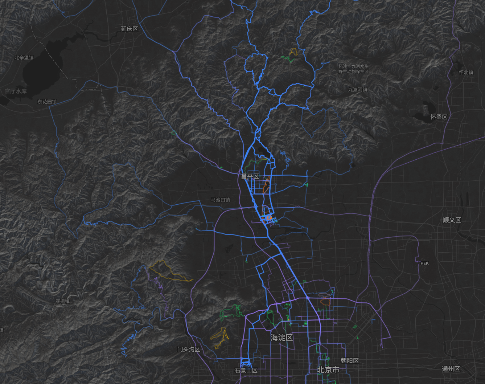
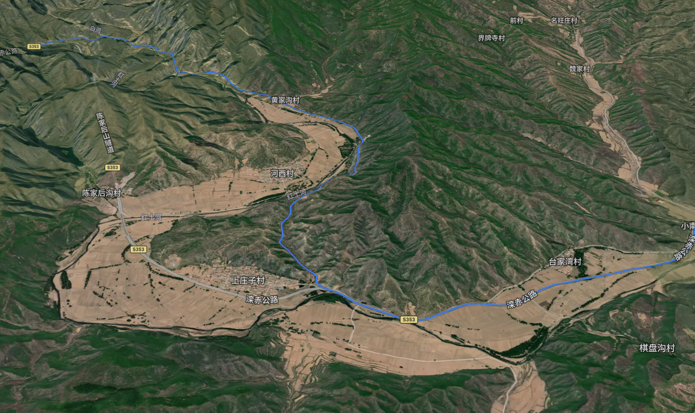
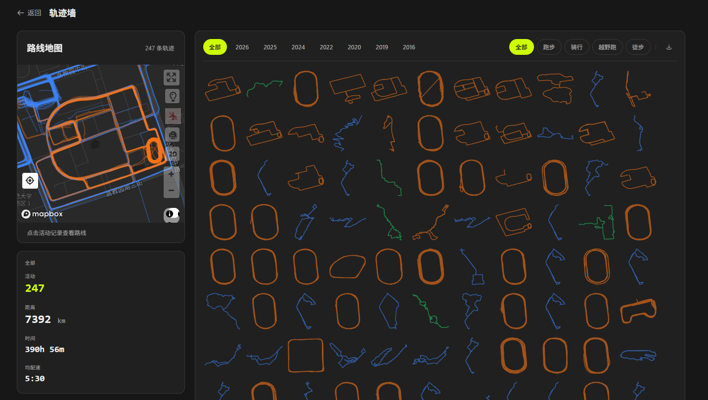
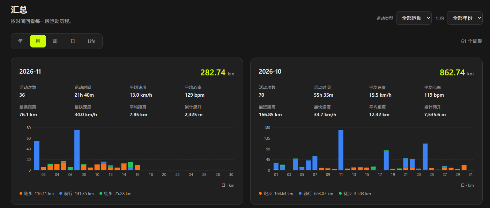
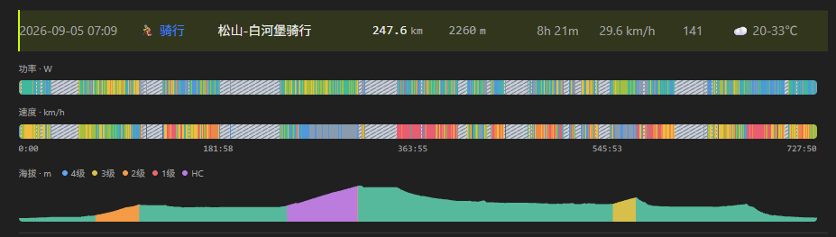
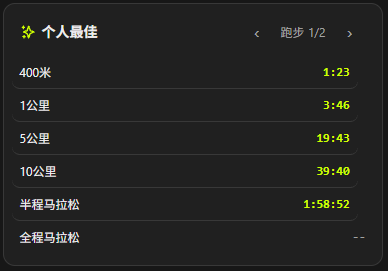

# Neewii Workouts

**简体中文** · [English](README-EN.md)

本项目的框架完全来自 [yihong0618/running_page](https://github.com/yihong0618/running_page)，并在此基础上做了一点点个人化调整。

把运动与出行记录留在自己的地图上。

一个基于 React、TypeScript、Vite 与 Python 的个人运动主页，展示跑步、越野跑、骑行、徒步等运动，也记录自驾、飞行与铁路旅程。通过 GitHub Actions 同步数据，构建后可部署为静态网站。



_把一次次跑步、骑行与出行连在一起，看看自己走过的地方。_

## 项目来源

| 来源                                                                                            | 参考与继承的内容                                                                                    |
| ----------------------------------------------------------------------------------------------- | --------------------------------------------------------------------------------------------------- |
| [yihong0618/running_page](https://github.com/yihong0618/running_page)                           | 项目主要基础，包括活动同步、数据存储、地图展示及统计图生成；新版页面也适配了其中的 Dashboard 组件。 |
| [ben-29](https://github.com/ben-29) 的 [workouts_page](https://github.com/ben-29/workouts_page) | 多运动类型识别、分类展示与户外运动主页的扩展思路。                                                  |
| [zhaohongxuan/workouts](https://github.com/zhaohongxuan/workouts)                               | 新版主页的设计参考，包括看板布局、活动热力图、轨迹墙与数据卡片的呈现方式。                          |

感谢原作者与贡献者的工作。下文介绍的是本仓库当前的整合与扩展；

## 可以看到什么

- **运动地图**：查看不同年份、运动类型和单次活动的路线，支持深浅主题、卫星底图、全屏与 3D 地图。
- **运动看板**：年度 / 月度 / 周目标、连续记录、活动热力图、分页活动列表、中国足迹与跑步散点图。
- **轨迹墙**：以路线缩略图回顾活动，支持筛选，并可将轨迹墙与热力图导出为图片。
- **多运动记录**：跑步、越野跑、骑行、室内与虚拟骑行、徒步、游泳、健身等类型共用一套活动数据。
- **旅行记录**：自驾、飞行、铁路路线与运动轨迹放在同一张地图上，同时与运动总量分开统计。
- **自动更新**：GitHub Actions 定时同步活动；Surge 可在代码更新或运动数据同步成功后自动发布。

## 本仓库的扩展

### 卫星底图与 3D 地形

本仓库新增了卫星底图与 3D 地形切换功能，可以结合真实地表影像和地形起伏回看路线，更直观地观察山中骑行、徒步与越野跑经过的山脊。通过地图上的底图与 2D / 3D 按钮切换。



### 经典主页与新版看板共存

保留 running page 早期的经典地图页面（怀旧），同时提供新版 Dashboard。两版共用活动数据和主题设置，切换时保留选中活动；浏览器会记住上次选择的主页版本。新版页面支持中英文切换。

| 页面                                           | 地址                 |
| ---------------------------------------------- | -------------------- |
| 主页入口，首次显示经典版，之后按浏览器记录选择 | `/`                  |
| 新版看板                                       | `/dashboard`         |
| 新版运动汇总                                   | `/dashboard/summary` |
| 经典主页                                       | `/classic`           |
| 经典运动汇总                                   | `/classic/summary`   |

### 轨迹墙与入选规则

轨迹墙把每次活动画成独立的路线缩略图，以不同颜色区分运动类型。点击缩略图可在旁边的地图中查看对应路线；支持按年份、运动类型筛选，按时间或距离排序，并可导出图片。



设置一个入选门槛，达到对应距离即可进入轨迹墙：

| 运动类型               | 默认最低距离 |
| ---------------------- | ------------ |
| 跑步                   | 5 公里       |
| 越野跑                 | 5 公里       |
| 徒步                   | 5 公里       |
| 骑行（包括虚拟骑行）   | 20 公里      |
| 其他计入运动统计的类型 | 10 公里      |

自驾、飞行和铁路不入选轨迹墙。

**门槛可以自行调整。** 修改 [`src/components/Dashboard/utils/trackWall.ts`](src/components/Dashboard/utils/trackWall.ts) 中 `isTrackWallActivity` 函数的 `minimumDistance` 规则即可，数值单位为米；例如将骑行的 `20000` 改为 `10000`，便可展示 10 公里及以上的骑行路线。

### 多运动汇总

新版 Summary 支持按年、月、周、日及 Life 汇总，结合运动类型与年份筛选，展示不同运动的统计和占比。

本仓库新增了**不同运动类型的距离贡献识别**：在“全部运动”视图中，柱状图按跑步、骑行、徒步、越野跑等类型分色堆叠，图例列出各类运动在当前汇总周期内的累计里程。这样既能看到一段时间的运动总量，也能看出这些里程分别由哪些运动贡献。



统计中，自驾、飞行、铁路保留在活动列表与地图中，但不计入运动总量和运动热力图。当前年 / 月 / 周目标按跑步类活动计算。

### 活动曲线与地图联动

在新版列表中选择活动，可展开配速、速度、功率、心率或海拔曲线，默认设计的门槛是：

- **跑步**：不设最低距离或时长门槛，有有效速度数据时显示配速曲线；有有效心率数据时增加心率曲线；累计爬升 **大于 200 米** 且有海拔数据时增加海拔曲线。
- **骑行**：不设最低距离或时长门槛，有有效功率数据时显示功率曲线，并在有速度数据时同时显示速度曲线；无有效功率数据时显示可用的速度曲线；累计爬升 **大于 200 米** 且有海拔数据时增加海拔曲线。估算功率会单独标注，当前不展示骑行心率曲线。
- **徒步**：累计爬升 **大于 200 米** 且有海拔数据时显示海拔曲线，当前不展示配速、速度、功率或心率曲线。
- **越野跑**：与跑步使用相同规则。

上述曲线目前由 Strava 数据流生成，需已同步到对应的有效数据；达到爬升门槛但缺少海拔数据时也不会显示海拔曲线。

曲线共用时间游标，地图上的位置点随游标移动；有 Strava 官方爬坡分级的活动还能在海拔曲线上查看对应区间。



_骑行活动示例：功率、速度与海拔沿同一时间轴展示，海拔曲线的不同颜色标出 Strava 官方爬坡分级区间。_

详细数据按活动单独保存、按需加载。Strava 同步会逐步补齐历史数据，并保留已完成的进度。详见[活动曲线与历史回填](docs/activity-timelines.md)。

### 跑步成绩与骑行功率纪录

- **跑步**：400 米、1 公里、5 公里、10 公里、半马与全马，读取 Strava 官方 `best_efforts`，使用包含停顿的实际经过时间。
- **骑行**：5 秒、1 分钟、5 分钟、20 分钟、40 分钟与 1 小时的最佳平均功率。



没有有效成绩时显示 `--`，不会用整次活动的平均配速推算个人最佳。骑行计算口径和回填方式见[个人最佳说明](docs/personal-bests-cn.md)。

### 自驾、飞行与铁路导入

可将本地 GPX、FIT 或 KML 路线导入相应类型，支持导入前检查、重复文件跳过、时区处理，以及为缺少时间戳的部分路线补充日期或起止时间。各类型支持的格式不同，见 [RoadTrip](roadtrip/README.md)、[Flight](flight/README.md) 和 [Train](train/README.md)。

## 新手部署：按这四步开始

### 1. 确认自己有可用的运动数据来源

先阅读 [running_page 的数据源与接入说明](https://github.com/yihong0618/running_page/blob/master/README-CN.md)，确认你使用的平台能否同步，以及需要准备哪些账号信息或授权。例如 Strava、Garmin、Nike、Keep、COROS，或者自行导出的 GPX / TCX / FIT 文件。

本仓库日常使用 Strava，也保留了多种上游同步脚本。上游的新功能不一定已经合入本仓库，决定使用前还需确认 `run_page/` 中有对应脚本。确认能取得自己的数据后，再进行下一步。

### 2. 清理旧数据，并同步自己的记录

Fork 本仓库到自己的 GitHub 账号，再将自己的副本克隆到本地。准备 Node.js 22，启用项目指定的 pnpm：

```bash
corepack enable
pnpm install --frozen-lockfile
```

本仓库已有维护者的展示记录。**首次使用自己的副本时，先预览清理范围，再重置旧数据：**

```bash
pnpm data:clean --dry-run
pnpm data:clean
```

清理命令适用于 Windows、macOS 与 Linux，会先把旧数据库、导入记录、曲线、导出文件和统计图移动到本地 `.local-backups/`，再初始化空的展示数据。备份不会提交到 GitHub；源码、凭据和文档图片保留。不要在正在同步数据时运行，也不需要每次更新都清理。

接着按自己的平台填写 GitHub Actions Secrets，修改 `.github/workflows/run_data_sync.yml` 的 `RUN_TYPE` 和个人资料，提交并推送清理结果及配置，再手动运行 **Run Data Sync**。使用本地轨迹文件的用户则运行对应导入脚本。具体配置见[新手接入指南](docs/getting-started-cn.md)。

同步成功后，用 `pnpm dev` 查看自己的记录，生产构建为 `pnpm build`，输出目录是 `dist/`。请先确认活动和统计已经变成自己的数据，再发布网站。

### 3. 申请自己的地图 Token（可选）

本步骤可以跳过，不影响路线展示，只不过不显示地图底图。

登录 [Mapbox](https://account.mapbox.com/access-tokens/)，申请自己的公开 Token，将 [`src/utils/const.ts`](src/utils/const.ts) 中的 `MAPBOX_TOKEN` 替换为自己的值。

当前普通底图、卫星底图与 3D 地形都使用 Mapbox。不要继续使用仓库继承的 Token；公开 Token 会在浏览器中使用，建议在 Mapbox 设置允许访问的域名。本地预览时允许本机地址，拿到部署域名后再补充该域名。

### 4. 选择托管平台，发布自己的网站

可以选择 Vercel 或 Surge.sh。托管平台负责构建和发布网页，运动平台凭据仍按第二步配置在 GitHub Actions 中。

#### Vercel：通过网页部署

1. 登录 [Vercel](https://vercel.com/)，选择 **Add New → Project**，连接 GitHub 并导入自己的仓库。
2. Framework Preset 选择 **Vite**，Root Directory 保持项目根目录，确认以下配置：

   | 配置             | 值                               |
   | ---------------- | -------------------------------- |
   | Node.js          | `22.x`                           |
   | Install Command  | `pnpm install --frozen-lockfile` |
   | Build Command    | `pnpm build`                     |
   | Output Directory | `dist`                           |

3. 根域名部署时 `PATH_PREFIX` 不用设置；如果已有此环境变量，将其设为 `/`。保留仓库中的 `vercel.json`，用于支持子页面刷新。
4. 点击 **Deploy**，等待构建完成，即可通过分配的 `*.vercel.app` 域名访问。之后推送到生产分支的普通代码更新会触发重新部署。

#### Surge.sh：首次配置后自动部署

Surge 首次登录和生成 Token 需要终端，之后可通过 GitHub 网页查看和手动触发部署。

1. 在自己的终端运行以下命令，将 `your-site.surge.sh` 替换为你选择的域名，并按提示完成登录与邮箱验证：

   ```bash
   npx --yes surge@0.57.1 login
   npx --yes surge@0.57.1 tokens add --domain your-site.surge.sh -m "github actions"
   ```

2. 打开自己的 GitHub 仓库 **Settings → Secrets and variables → Actions**，添加：

   | 位置      | 名称           | 内容                                                        |
   | --------- | -------------- | ----------------------------------------------------------- |
   | Secrets   | `SURGE_TOKEN`  | 上一步生成的 Token                                          |
   | Variables | `SURGE_DOMAIN` | 你的域名，例如 `your-site.surge.sh`，不含 `https://` 和路径 |

3. 确认 `.github/workflows/surge.yml` 已在默认分支 `main`，在仓库 **Actions** 页面启用工作流，选择 **Publish Surge → Run workflow → main**，启动首次部署。
4. 运行成功后，在该次运行的 Summary 中打开站点链接。此后 `main` 更新或 **Run Data Sync** 成功完成，都会自动重新发布。保留 `SAVE_DATA_IN_GITHUB_CACHE: false`，让部署读取提交到仓库的最新数据。

Surge 工作流已自动生成 `200.html`，无需手动处理子页面路由。运动平台凭据仍配置在 GitHub Actions 中；发布网站与同步运动数据的详细步骤见[部署与自动更新](docs/deployment-cn.md)和[开始使用](docs/getting-started-cn.md)。地图 Key 如有域名白名单，也要添加新的部署域名。

## 更多使用说明

数据流为：**运动平台 / 本地轨迹 → Python 导入与 SQLite → 活动 JSON / 统计 SVG → Vite 构建 → 静态站点**。

- [新手接入指南](docs/getting-started-cn.md)：数据源、清理命令、同步与个人配置。
- [部署与自动更新](docs/deployment-cn.md)：Vercel、Surge 与 GitHub Pages 的详细说明。
- [活动曲线与历史回填](docs/activity-timelines.md)、[个人最佳](docs/personal-bests-cn.md)。
- [自驾与飞行导入](docs/flight-roadtrip-cn.md)、[铁路导入](train/README.md)。

## 仓库结构

```text
src/                         网页源码、个人配置与活动 JSON
  components/Dashboard/      新版看板组件及其许可
  static/                    站点资料、活动数据与地点信息
run_page/                    Python 同步、导入、统计与 SQLite 数据库
public/data/                 按活动保存的曲线数据及兼容迁移数据
assets/                      经典主页使用的统计 SVG 与资源入口
flight/ roadtrip/ train/      旅行路线输入目录与使用说明
GPX_OUT/ TCX_OUT/ FIT_OUT/     平台导出文件或手动导入文件的目录
activities/ Workouts/         部分同步器使用的数据目录
PNG_OUT/                     分享图片输出目录，生成图片不纳入版本管理
docs/                        使用、部署与功能说明
tests/                       前端与 Python 回归测试
.github/workflows/           数据同步、部署与 CI
```

`run_page/data.db`、`src/static/activities.json`、`assets/` 中的统计图及 `public/data/` 是当前站点的数据，不是临时备份。具体维护方式见[开始使用](docs/getting-started-cn.md)，文档索引见 [docs](docs/README.md)。

## 开源许可

沿用 [MIT License](LICENSE)，保留原作者的版权和许可声明。新版组件的许可同时保存在 [src/components/Dashboard/LICENSE](src/components/Dashboard/LICENSE)，历史适配参考的 running_page 版本为 [`61563c0`](https://github.com/yihong0618/running_page/commit/61563c049c75dc8813283d1a109941d751dcd0d4)。复用代码时请一并保留相应声明。
